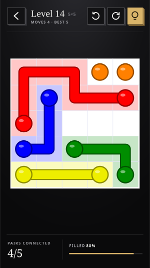

# Vine Link

A calm, premium path-connecting puzzle for your phone. Draw pipes to link matching colored dots
without crossing, until every cell on the board is filled.

<p align="center">
  
</p>

<p align="center">
  <b><a href="https://tejas28599-ship-it.github.io/vine-link/">▶ Play Vine Link</a></b>
  &nbsp;·&nbsp; works on any phone, tablet or desktop browser · installable · plays offline
</p>

Built with plain HTML, CSS and vanilla JavaScript: no frameworks, no dependencies, no build step.

## How to play

1. **Drag from a dot** to the other dot of the same color to draw a pipe between them.
2. Pipes move up, down, left and right. They **can't cross or overlap**. Draw over another pipe and
   it gets cut back (pull away again during the same drag and it grows back).
3. Drag back along a pipe to shorten it. **Tap a dot** to clear its pipe.
4. The level is solved when **every pair is connected and every cell is filled**.

Fewer moves is better. A *move* is drawing a different color than the one you drew last, so
connecting each pair in one go earns a **Perfect** star.

## Features

- **120 levels** in four packs, every one with **exactly one solution**:

  | Pack     | Grid          | What's new |
  |----------|---------------|------------|
  | Starter  | 5×5 – 6×6     | Levels 1–3 are a gentle tutorial |
  | Classic  | 7×7 – 8×8     | **Blocked cells (×)**: pipes must go around them |
  | Advanced | 9×9 – 10×10   | **Bridges**: one pipe crosses left–right, another top–bottom |
  | Expert   | 11×11 – 12×12 | Long, winding pipes with fewer colors per cell |

- **Daily Puzzle:** a new puzzle every day, built from the date, so everyone plays the same one.
- **Hints:** the lightbulb draws one correct pipe for you (3 per level; undo doesn't refund them).
- **Undo and restart**, plus your **best** (lowest) move count for every level.
- **Progress is saved automatically**, including a level you're halfway through. Refresh or close
  the app and you're right back where you were.
- A one-screen **tutorial** the first time you meet each new idea.
- **Sound effects** made live with the Web Audio API: rising tones while you draw, a chime per
  color when a pair connects, a gentle melody when you win. Plus a light **vibration** on connect.
- **Settings:** sound, vibration and **colorblind mode**, which puts a unique symbol on every dot.

## Look and feel

The design is inspired by CRED's NeoPOP style:

- A rich **charcoal** background with soft light from the top and a fine film grain.
- **NeoPOP buttons:** sharp rectangles with a solid 3D edge that the button slides into when you
  press it. White for the main action, black for the rest, gold for hints.
- An elegant **serif** for headlines (DM Serif Display), a clean **sans** (Manrope) with small
  spaced capitals for labels, thin hairline dividers and muted **gold** accents.
- A bright **white board** that floats on the dark background. Pipes are bold with a darker
  outline, dots are glossy, and filled cells take a soft tint of their pipe's color.

### Colors

The classic, fully saturated puzzle palette, ordered so small levels use the most distinct colors:

| | | | | | |
|---|---|---|---|---|---|
| Red `#FF0000` | Green `#008D00` | Blue `#0000FF` | Yellow `#EEEE00` | Orange `#FF8000` | Cyan `#00FFFF` |
| Magenta `#FF00FF` | Pink `#FF8FC8` | Purple `#800080` | Brown `#8B5A2B` | Gray `#A6A6A6` | Lime `#00FF00` |

## Install it on your phone

Vine Link is a Progressive Web App:

- **iPhone (Safari):** open the game, tap **Share**, then **Add to Home Screen**.
- **Android (Chrome):** open the game, tap the **⋮** menu, then **Install app** (or **Add to Home
  screen**).

It then opens full screen like a native app and keeps working without an internet connection
(the two web fonts fall back to built-in ones when offline).

## Keyboard shortcuts (desktop)

| Key | Action |
|-----|--------|
| `Ctrl/⌘ + Z`, `U` or `Backspace` | Undo |
| `R` | Restart the level |
| `H` | Hint |
| `Enter` | Next level (on the win screen) |
| `Esc` | Close a dialog |

## Run it locally

ES modules and the service worker need a real web server (opening `index.html` as a file won't
work). Any static server is fine:

```bash
node tools/serve.js
```

Then open http://localhost:8080. Alternatives: `python3 -m http.server 8080` or `npx serve`.

To try it on your phone, serve on your local network (for example
`python3 -m http.server 8080 --bind 0.0.0.0`) and open `http://<your-computer-ip>:8080`.
Add `?debug` to the URL to expose `window.__vine` in the console.

### Tests

Needs Node 18+ and nothing else:

```bash
npm test
```

29 tests cover the rules engine (cutting, shrinking, bridges, undo, hints, save/restore),
storage, gap-free swipe tracking, and **all 120 levels** (unique solution, solver speed,
difficulty curve, deterministic generation) plus the Daily Puzzle.

### Regenerating levels

Levels come from a seeded generator, so level N is always identical. They're pre-generated into
`levels.json`, because proving that a 12×12 board has only one solution takes a while:

```bash
npm run generate                       # all 120 levels, uses every CPU core
node tools/generate-levels.js 91 120   # just a range
```

If `levels.json` can't be loaded, the game generates the same levels in the browser.

The app icons are drawn by a small script with no image tools needed: `npm run icons`.

## How it works

- **Rules** (`js/game.js`) are pure functions over a *lane graph*: each cell is one node and each
  bridge is two (a horizontal and a vertical lane), so bridges need no special cases anywhere.
- **Solver** (`js/solver.js`) grows every pair from both ends, always extending the most
  constrained one, and prunes dead ends and unreachable regions. Asking it for up to two
  solutions proves a level is unique.
- **Generator** (`js/levels.js`) fills the board with random winding paths, repairs and merges
  them toward a target number of colors, then lets the solver check uniqueness. Wherever a second
  solution exists, it splits a path to pin that region down.
- **Input** (`js/input.js`) tracks a single finger and fills in every cell a fast swipe passes
  over, so diagonal flicks never skip cells.

## Project layout

```
index.html            screens, HUD, dialogs
css/style.css         NeoPOP-inspired theme + responsive layout (safe areas, 360px phones → tablets)
js/game.js            pure rules: lane graph, pipes, cutting, undo, win check, hints
js/solver.js          backtracking solver (counts solutions → uniqueness)
js/levels.js          seeded RNG, generator, packs, difficulty curve, Daily Puzzle
js/render.js          canvas renderer: white board, outlined pipes, glossy dots, tinted cells, confetti
js/input.js           single-finger pointer input with gap-free swipe tracking
js/audio.js           Web Audio sound effects
js/storage.js         localStorage save data (every access wrapped in try/catch)
js/palette.js         pipe colors + colorblind symbols
js/app.js             screens and glue
sw.js, manifest.json  PWA: offline cache and install
levels.json           the pre-generated campaign
tools/                level generator, icon maker, tiny static server
tests/                node --test suites
docs/                 design notes and the README preview image
```

## Deploying

GitHub Pages serves the repo straight from `main` (root folder). Push and it's live in about a
minute. When you change any cached file, bump `VERSION` in `sw.js`. The service worker loads from
the network first, so players get updates right away and fall back to the cache when offline.

## Credits

- Fonts: [DM Serif Display](https://fonts.google.com/specimen/DM+Serif+Display) and
  [Manrope](https://fonts.google.com/specimen/Manrope) (SIL Open Font License), via Google Fonts.
- Visual style inspired by CRED's NeoPOP design language. Gameplay is in the tradition of classic
  "connect the dots" path puzzles. All code, levels, art and sounds are original to this project.
